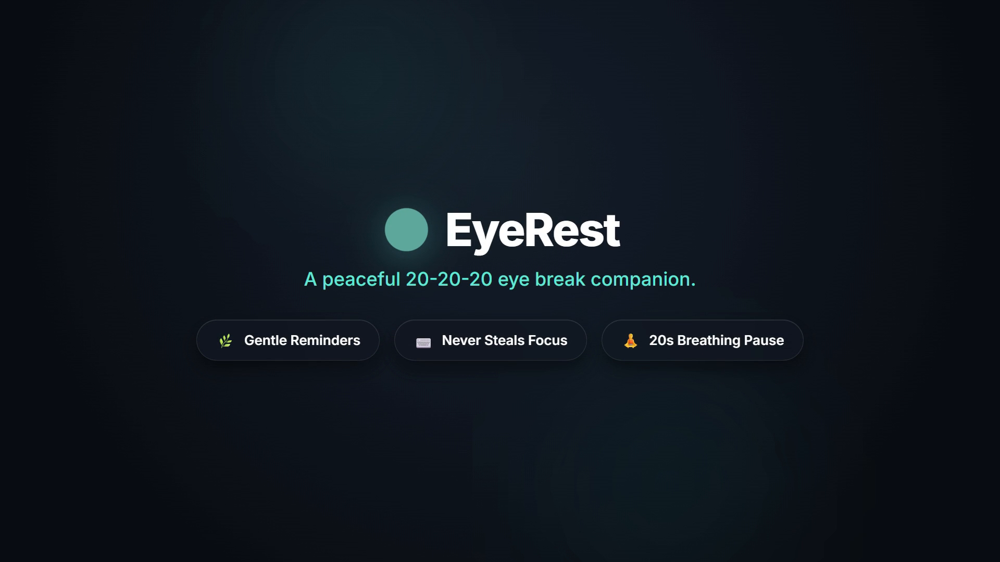
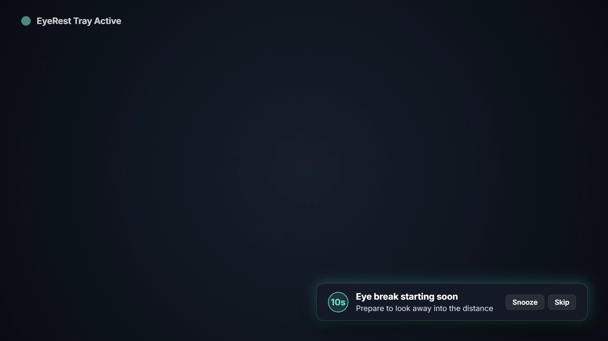
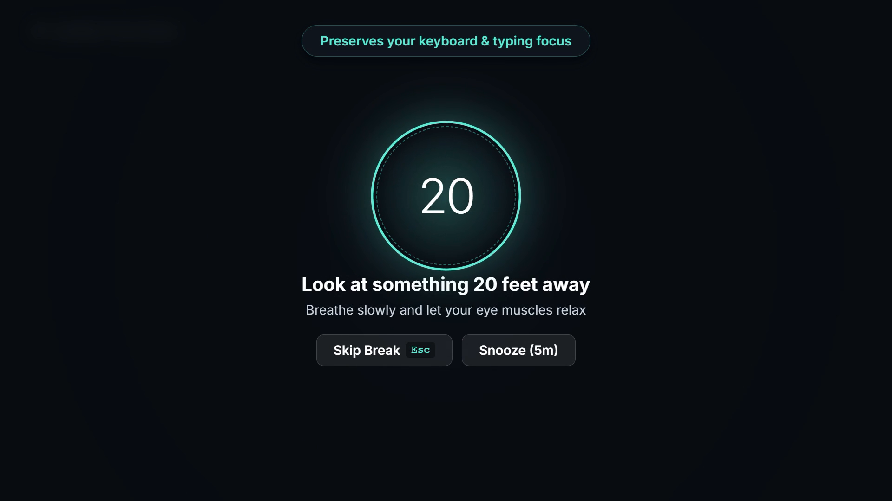

<div align="center">

# EyeRest 🌿

**A quiet, peaceful Windows companion for healthy screen habits.**  
*Protect your vision with gentle 20-20-20 eye breaks — without ever breaking your flow.*

[](https://github.com/HassaanGhayas/eye-rest)
[](https://www.rust-lang.org/)
[](https://tauri.app/)
[](#-performance--footprint)
[](#-installation--downloads)
[](LICENSE)

<br />



</div>

<br />

## 📖 The 20-20-20 Rule

Staring at digital screens for hours leads to computer vision syndrome, dry eyes, and mental fatigue. The **20-20-20 rule** is an ophthalmologist-recommended standard:

> **Every 20 minutes, look at an object at least 20 feet away for at least 20 seconds.**

Most reminder apps are disruptive: they pop up aggressively, steal your keyboard cursor while you are in the middle of typing a sentence, or consume hundreds of megabytes of system memory.

**EyeRest** was crafted to be different: quiet, respectful, and native. It lives quietly in your system tray, warns you gently before a break begins, and guides you through a calming 20-second pause with a meditation breathing circle.

---

## 🎬 Preview in Action

<div align="center">
  
  <p><em>Pre-break corner toast notification ➔ Smooth transition to calm breathing overlay</em></p>
</div>

> 🎥 **Full Launch Showcase Video:** Check out the high-definition launch video in [`brag-output/brag.mp4`](brag-output/brag.mp4) or the full audio-visual storyboard in [`brag-output/brag-plan.md`](brag-output/brag-plan.md).

---

## ✨ Key Features

### 🌿 Gentle 10-Second Pre-Break Toast
A subtle floating card appears in the corner of your active monitor 10 seconds before a break begins. You are never blindsided—you always have time to finish your thought, save your work, or click **Snooze**.

<div align="center">
  
</div>

### 🧘 Calming Zen Overlay & Breathing Guide
When the break starts, your screen smoothly dims into a distraction-free relaxation space:
- **Expanding & contracting breathing circle** to guide steady, relaxed breathing.
- **20-second countdown timer** to let your eye muscles fully decompress.
- **Tibetan singing bowl chime (432 Hz)** that sounds gently at break start (can be muted in Preferences).

<div align="center">
  
</div>

### ⌨️ Never Steals Keyboard Focus
EyeRest uses native Windows extended window styles (`WS_EX_NOACTIVATE` and `SWP_NOACTIVATE`). Your active text editor, terminal, or document **never loses cursor position or keyboard focus**. If you need to dismiss early, just tap <kbd>Esc</kbd>.

### 🖥️ Multi-Monitor Intelligent Targeting
EyeRest automatically detects which display contains your active foreground window (`MonitorFromWindow`). The pre-break toast and break overlay appear strictly on the monitor you are currently looking at.

### 🎮 Smart Environmental Watchers
- **Idle Detection**: Automatically resets your work timer if you step away from your desk for more than 2 minutes (`GetLastInputInfo`).
- **Fullscreen & Presentation Guard**: Automatically defers eye breaks if you are gaming, watching a full-screen video, or giving a presentation (`SHQueryUserNotificationState`).
- **Lock / Sleep Awareness**: Automatically pauses when Windows locks or goes to sleep, and resumes seamlessly when unlocked.

### 🔒 100% Private & Standalone
- **Zero telemetry**: No analytics, tracking, or network calls.
- **Zero accounts**: No sign-ups or cloud sync needed.
- **Local storage**: Preferences are stored cleanly in `%APPDATA%\EyeRest\settings.json`.

---

## ⚡ Performance & Footprint

EyeRest is engineered in Rust with direct Win32 API bindings and vanilla UI components to deliver maximum efficiency:

| Metric | EyeRest 🌿 |
|---|---|
| **Installer Size** | **1.16 MB** |
| **Standalone Binary** | **2.81 MB** |
| **Idle Memory (Private Bytes)** | **~9.3 MB** |
| **Working Set Memory** | **~30.8 MB** (with automatic Win32 memory trimming) |
| **Idle CPU Usage** | **0.0%** |
| **Keyboard Focus Stealing** | **None** (`WS_EX_NOACTIVATE`) |
| **Network Requests** | **0 (Completely offline)** |

---

## 🚀 Installation & Downloads

### 1. Windows Installer (Recommended)
Download and run the NSIS installer:
```text
EyeRest_0.1.0_x64-setup.exe
```
This installs EyeRest to your user profile and creates convenient Start Menu shortcuts.

### 2. Standalone Portable Binary
You can also run `eyerest.exe` directly without installation:
```text
eyerest.exe
```

---

## 🍃 System Tray Controls

EyeRest runs quietly in the Windows Notification Area (System Tray). Right-click the leaf icon to access:

- **Take break now**: Manually trigger a 20-second eye break at any time.
- **Pause / Resume**: Freeze or resume the background timer.
- **Skip next break**: Reset the timer back to the beginning of the next work cycle.
- **Snooze**: Postpone breaks for **5 minutes**, **1 hour**, or **until 4:00 AM tomorrow**.
- **Preferences...**: Open the settings panel to configure intervals and behavior.
- **Quit**: Completely exit EyeRest.

---

## ⚙️ Configurable Preferences

Customize EyeRest to match your work rhythm:
- **Work Interval**: 1 to 120 minutes (default: 20 minutes)
- **Break Duration**: 5 to 300 seconds (default: 20 seconds)
- **Strict Mode**: Hides the skip button and disables the <kbd>Esc</kbd> dismiss shortcut for disciplined breaks.
- **Sound Chime**: Toggle the 432 Hz singing bowl chime on/off.
- **Launch on Startup**: Automatically starts with Windows (`HKCU\Software\Microsoft\Windows\CurrentVersion\Run`).
- **Themes**: Dark theme, Light theme, or System default.

---

## 🛠️ Building from Source

### Prerequisites
- **Windows 10 or 11 (64-bit)**
- **Rust toolchain** (`rustup default stable-x86_64-pc-windows-msvc`)
- **Node.js** (v18+) & **npm**

### 1. Compile the Release Executable
```powershell
# Set cargo cache if custom home is used
$env:CARGO_HOME = "d:\EyeRest\.cargo_home"

# Build optimized binary
Set-Location src-tauri
cargo build --release
```
The standalone executable will be generated at:
`src-tauri\target\release\eyerest.exe`

### 2. Build the Windows Installer
```powershell
npm run tauri -- build --bundles nsis
```
The installer package will be output to:
`src-tauri\target\release\bundle\nsis\EyeRest_0.1.0_x64-setup.exe`

### 3. Run Automated Unit Tests
```powershell
Set-Location src-tauri
cargo test --lib -- --nocapture
```

---

## 🏛️ Architecture

- **Backend**: Rust 2021 with [Tauri v2](https://tauri.app/) and the [`windows`](https://crates.io/crates/windows) crate for direct Win32 system calls.
- **Frontend**: Lightweight vanilla HTML5, CSS3, and ECMAScript without heavy JavaScript frameworks or virtual DOM overhead.
- **Window Management**: Uses Win32 extended window styles `WS_EX_NOACTIVATE` and `SWP_NOACTIVATE` to preserve user input focus during break phases.
- **Memory Trimming**: Automatically calls `SetProcessWorkingSetSize` after breaks to release inactive memory pages back to the operating system.

---

## 🤝 Contributing

Contributions, bug reports, and feature suggestions are welcome!
1. Fork the repository.
2. Create your feature branch (`git checkout -b feature/cool-idea`).
3. Commit your changes (`git commit -m 'feat: add cool idea'`).
4. Push to the branch (`git push origin feature/cool-idea`).
5. Open a Pull Request.

---

## 📄 License

EyeRest is open-source software licensed under the [MIT License](LICENSE).
